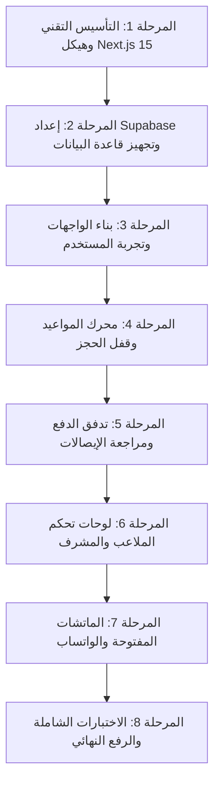

# وثيقة المواصفات الفنية وخريطة الطريق التنفيذية للمشروع
# Project Blueprint & Engineering Specification
# المنصة الرسمية: باصيلي (Passyli) — «احجز ملعبك، كمّل ماتشك»

---

## 1. نظرة عامة على المشروع (Executive Summary)

* **اسم المنصة:** **باصيلي (Passyli)**
* **النطاق المستهدف:** `passyli.com` / `passyli.app`
* **السلوجان الرسمي:** *"باصيلي — احجز ملعبك، كمّل ماتشك"*
* **النشاط:** منصة لحجز وإدارة ملاعب كرة القدم الخماسي وملاعب البادل (Multi-Vendor Sports Court Marketplace).
* **النطاق الجغرافي الأولي:** جمهورية مصر العربية - محافظة البحيرة (مدينة دمنهور)، مع جاهزية معمارية للتوسع لجميع المحافظات.
* **نموذج العمل:** منصة سحابية تتيح لأصحاب الملاعب إدارة منشآتهم ومواعيدهم وحجوزاتهم، وتتيح للعملاء البحث، المقارنة، والحجز الفوري.
* **آلية الدفع في الإصدار الأول (MVP):** 
  * خيارات الدفع: دفع عربون (Deposit) أو سداد كامل المبلغ (Full Amount).
  * قنوات التحويل: **إنستاباي (InstaPay)** أو **فودافون كاش (Vodafone Cash)** الخاصة بالملعب مباشرة (مع دعم حسابات احتياطية عند امتلاء المحافظ).
  * التحقق: رفع سكرين شوت إيصال التحويل مع ضغط الصورة تلقائياً في المتصفح (< 200KB) + تسجيل الرقم المرجعي (Ref Number)، ومراجعتها بضغطة زر واحدة من إدارة الملعب.

---

## 2. أطراف النظام والصلاحيات (User Roles & RBAC)

1. **العميل (Player / Booker):**
   * البحث عن الملاعب القريبة جغرافياً وتحديد المسافة بالكيلومتر تلقائياً (GPS Geolocation).
   * استعراض المواعيد المتاحة والأسعار الصباحية والمسائية.
   * قفل الموعد مؤقتاً لمدة 8 دقائق أثناء التحويل مع عداد تنازلي رقمي.
   * رفع إيصال التحويل والحصول على تذكرة رقمية (Booking Pass) توضح ببنط عريض المدفوع والمتبقي كاش.
   * إمكانية طلب تعديل موعد الحجز (Reschedule) بدلاً من الإلغاء قبل الموعد بـ 12 ساعة.
   * المشاركة في الماتشات المفتوحة (Matchmaking).
2. **صاحب الملعب (Venue Owner):**
   * إدارة تفاصيل الملعب، الصور، والخدمات المتاحة.
   * تخصيص فترات الحجز (60 دقيقة للخماسي، 90 دقيقة للبادل).
   * ضبط جداول الأسعار وساعات الذروة والعطلات وتحديد وقت فاصل (Buffer Time 5 دقائق).
   * إضافة أرقام محافظ متعددة (أساسي واحتياطي) لتفادي حدود المحافظ الشهرية.
   * مراجعة إيصالات التحويل واعتمادها أو تعديل المبلغ المحول فعلياً (Underpayment) أو الرفض مع ذكر السبب.
   * تفعيل زر طوارئ الصيانة والظروف القاهرة (Force Majeure) لتأجيل أو إلغاء مواعيد فترة محددة وإشعار اللاعبين.
3. **موظف الاستقبال / كابتن الملعب (Field Staff / Receptionist):**
   * وضع الموظف السريع (Staff Mode): متابعة جدول اليوم الزمني لحظياً (Timeline Calendar).
   * زر قفل الساعة كاش فوري بلمسة واحدة (Walk-in Booking) لمن يحضر للملعب دون إنترنت.
   * تسجيل الحضور والدفع النقدي للمتبقي في الملعب.
   * حظر الوصول للبيانات المالية وصافي أرباح المالك.
4. **المشرف العام (Super Admin):**
   * مراجعة وتفعيل الملاعب الجديدة والتحقق من هويتها قبل ظهورها للجمهور.
   * مراقبة عمليات التحويل وتفعيل الحظر النهائي (Blacklist) لأي رقم هاتف يتلاعب بالإيصالات.
   * إدارة عمولات المنصة وتقارير النمو.

---

## 3. ميثاق نظام التصميم الصارم وهيكل الشعار الرسمي (Strict Enterprise Design & Official Brand)

تم اعتماد **الخيار رقم 1 (الهوية الحركية المتكاملة)** رسمياً كشعار رسمي معتمد لمنصة «باصيلي»:

### 1. تفاصيل الشعار المعتمد رسميًا (Official Brand Lockup - Option 1)
* **الأيقونة الرسمية (The Speed P):**
  * حرف **P** رياضي مصمم بزاوية انطلاق رشيقة (12 درجة)، مدمج معه في المساحة السلبية كرة الهدف البيضاء (Pitch Ball)، داخل إطار هندسي (Squircle) داكن مع حدود زمردية متوهجة.
* **التايبوجرافي الإنجليزي (English Wordmark):**
  * كلمة **Passyli** بخط هندسي عريض (`Inter 900`)؛ مقطع `Passy` بالأبيض الصافي، ومقطع `li` بالأخضر الزمردي (`#10b981`).
* **التايبوجرافي العربي المعتمد (Arabic Wordmark):**
  * خط هندسي عريض وفاخر (`Alexandria 900`) بتناغم لوني كامل:  
    كلمة **`باصـ`** بالأبيض الصافي + مقطع **`يلي`** بالأخضر الزمردي (`#10b981`).
  * تماثل بصري وهندسي 100% بين اللغتين بدون أي فواصل عشوائية.

### 2. سياسة منع الإيموجي الصارمة (Zero Emojis Policy)
* يُحظر تماماً استخدام أي رمز تعبيري (مثل ⚽، 🔥، 🏆) في الواجهات، البطاقات، الأزرار، أو الإشعارات.
* البديل المعتمد: مؤشرات الحالة النقطية الهندسية (Dot Status Indicators) وأيقونات الـ SVG المعمارية.

### 3. منظومة الأيقونات (Iconography)
* اعتماد حزمة **Lucide React** بوزن خط موحد وثابت (`strokeWidth={1.5}`).
* لا أيقونات كرتونية أو متفاوتة الأحجام؛ جميع الأيقونات بقياسات هندسية منسقة (16px, 20px, 24px).

### 4. الخطوط والطباعة (Typography Hierarchy)
* **اللغة العربية:** خط **Alexandria** (للشعارات والعناوين البارزة) و **IBM Plex Sans Arabic** (للنصوص والبطاقات).
* **الأرقام والإنجليزية:** خط **Inter 900** و **Geist Sans**.
* **الأرقام المالية والمواعيد:** تطبيق خاصية `font-variant-numeric: tabular-nums` لثبات الأرقام ومنع ارتعاش الواجهة أثناء التحديث.

### 5. لوحة الألوان المحايدة (Color Palette & Tokens)
* **الخلفيات والأسطح:** درجات Zinc/Slate الداكنة المحايدة (`#09090b` و `#18181b` و `#27272a`).
* **الحدود الفاصلة:** حدود دقيقة 1px شبه شفافة (`border-zinc-800/60`).
* **لون التمييز (Primary Accent):** لون أخضر الملاعب الزمردي الفاخر (`#10b981`) الخالي من التوهج الاصطناعي الفاقع.
* **التباين (Contrast):** التزام تام بمعايير WCAG AA لضمان وضوح الشاشة تحت أشعة الشمس المباشرة.

### 6. شروط تجربة المستخدم للهاتف (Mobile-First Constraints)
* **Touch Targets:** جميع أزرار الحجز وخانات الساعات بمقاس أدنى **44px × 44px**.
* **Bottom Navigation Bar:** شريط تنقل سفلي ثابت وسريع للوصول الفوري للشاشات الرئيسية.
* **حالات الشاشات الأربعة:** تغطية إلزامية لكل من (Loaded, Shimmer Skeleton, Empty State, Error State).

---

## 4. البنية التقنية (Technology Stack)

| الطبقة | التقنية | الغرض |
| :--- | :--- | :--- |
| **Framework** | **Next.js 15 (App Router)** | أداء فائق، Server Components لتقليل استهلاك الموبايل، ودعم SEO. |
| **Language** | **TypeScript** | أمان كامل لمنع الأخطاء البرمجية وضمان تناسق البيانات. |
| **Styling** | **Tailwind CSS + Shadcn UI** | نظام مكونات معياري قابل للتخصيص الكامل وخالي من التبعيات الزائدة. |
| **Database** | **Supabase (PostgreSQL)** | محرك قواعد بيانات علائقية متقدم يدعم المعاملات الصارمة (ACID Transactions). |
| **File Storage** | **Supabase Storage** | تخزين سحابي آمن لصور الملاعب وسكرين شوتات التحويل. |
| **Realtime** | **Supabase Realtime WebSockets** | تحديث المواعيد وحالة الحجز لحظياً دون الحاجة لإعادة تحميل الصفحة. |
| **Hosting & CI/CD** | **GitHub + Vercel** | أتمتة الرفع واختبار الأكواد واستضافة سحابية ذاتية التوسع (Auto-scaling). |

---

## 5. هندسة المواعيد والدفع ومنع التعارض (Slot Engine & Concurrency)

* **قيد محرك قاعدة البيانات:** `UNIQUE(court_id, booking_date, start_time)`.
* **قفل الموعد المؤقت الذكي (The 8-Minute Hold):**
  * مدة القفل: **8 دقائق** مع عداد تنازلي في صفحة الدفع.
  * تحرير فوري عند الضغط على "رجوع" أو "إلغاء" عبر `navigator.sendBeacon`.
  * تحرير تلقائي عند انتهاء الوقت عبر استعلام `WHERE locked_until < NOW()`.
  * حماية من التعطيل المتعمد (Anti-Spam): منع نفس الرقم من حجز أكثر من ميعاد مؤقت في نفس اللحظة.
* **ضغط الصور في المتصفح (Client-side Compression):** تحويل الصور وسكرين شوتات الإيصالات إلى حجم أقل من 200KB لرفع فوري على شبكات 3G/4G الضعيفة.
* **التذكرة الرقمية الصريحة:** توضيح المبلغ المدفوع إلكترونياً، والمتبقي كاش لتفادي أي احتكاك على دكة الملعب.

---

## 6. تحليل المنافسين ومكامن القوة التنافسية (Competitive Analysis & Edge)

| المنافس في مصر | نقاط الضعف والشكاوى الشائعة | الحل الهندسي المعتمد في باصيلي (Passyli) |
| :--- | :--- | :--- |
| **يلا حجز (Yalla Hagz)** | الحجز المزدوج مع حارس الملعب الكاش، بطء التطبيق في الويك إند، وصور لا تطابق جودة الملاعب الحقيقية. | **وضع موظف الاستقبال (Staff Mode)** بزر قفل كاش فوري + بنية **Next.js 15 Serverless** فائقة السرعة + اعتماد الملاعب بصور حقيقية وموثقة. |
| **ملعبي (Mal3aby)** | تعليق المبالغ في بوابات الدفع الإلكترونية، وصعوبة استرداد العربون، وواجهات مستخدم قديمة. | **التحويل المباشر** لإنستاباي وفودافون كاش دون وسيط مالي + إيصال رقمي يوضح المتبقي كاش لتفادي أي نزاع في الملعب. |
| **فاضية / كوريتي** | التركيز الحصري على القاهرة الكبرى وإهمال مدن الأقاليم، واشتراط بطاقات بنكية معقدة. | **التركيز على دمنهور والبحيرة** للسيطرة على السوق المحلي أولاً + دعم أسهل طرق الدفع الشعبية للمستخدم المصري. |

---

## 7. مصفوفة إدارة المخاطر والحلول التشغيلية (Risk Management Matrix)

1. **معضلة البداية:** البدء بـ 3 إلى 5 ملاعب مشهورة في دمنهور مجاناً 100% لأول شهرين وتفعيل ميزة ملء الساعات الصباحية الميتة بأسعار مخفضة.
2. **إهمال موظف الملعب ونسيان الحجز الكاش:** واجهة موبايل للموظف بزر واحد ضخم لقفل الساعة كاش مع إرسال تنبيه واتساب فوري له مع كل حجز أونلاين.
3. **تزوير أو تكرار الإيصالات:** فرض إدخال الرقم المرجعي للعملية (Ref Number) ومنع تكراره برمجياً في قاعدة البيانات وتفعيل الحظر النهائي لأي رقم متلاعب.
4. **التوسع متعدد المدن:** اعتماد الفرز الجغرافي الذكي (Coordinates + City Filtering) وحساب المسافات بالكيلومتر تلقائياً.

---

## 8. مراحل التطوير والخطوات التنفيذية (Roadmap)

* **المرحلة 1:** تهيئة Git، بناء مشروع Next.js 15، ضبط Tailwind والخطوط العربية، وتثبيت Shadcn UI.
* **المرحلة 2:** ربط Supabase، تنفيذ جداول الـ SQL والقيود الهندسية، وإنشاء حاويات التخزين (Buckets).
* **المرحلة 3:** برمجة الهيدر، الفلاتر السريعة، حساب المسافة بالكيلومتر عبر GPS، وكروت الملاعب التفاعلية.
* **المرحلة 4:** شبكة الساعات (60 دقيقة / 90 دقيقة)، تسعير أوقات الذروة، ونظام الحجز المؤقت (8 دقائق مع العداد).
* **المرحلة 5:** شاشة الدفع، عرض أرقام المحافظ، أداة رفع سكرين شوت الإيصال بضغط الصور، وإصدار التذكرة الرقمية.
* **المرحلة 6:** جدول الحجوزات الزمني للملعب، شاشة مراجعة الإيصالات، والحجز السريع اليدوي (Walk-in).
* **المرحلة 7:** ميزة الماتشات المفتوحة للمجموعات غير المكتملة، وتوليد رسائل الواتساب الآلية.
* **المرحلة 8:** فحص الأداء والأمان (Code Review & React Best Practices)، والرفع النهائي على Vercel مع الدومين.
