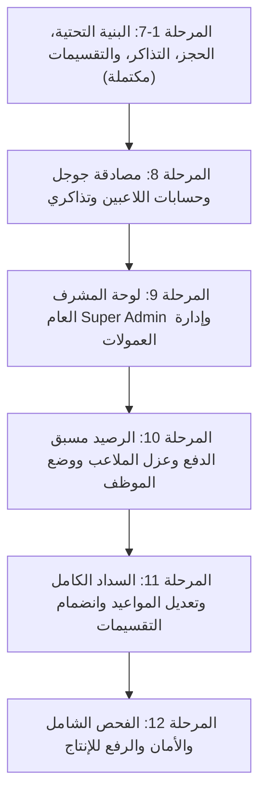

# وثيقة المواصفات الفنية وخريطة الطريق التنفيذية للمشروع
# Project Blueprint & Engineering Specification
# المنصة الرسمية: باصيلي (Passyli) — «احجز ملعبك، كمّل ماتشك»

---

## 1. نظرة عامة على المشروع (Executive Summary)

* **اسم المنصة:** **باصيلي (Passyli)**
* **النطاق المستهدف:** `passyli.com` / `passyli.app`
* **السلوجان الرسمي:** *"باصيلي — احجز ملعبك، كمّل ماتشك"*
* **النشاط:** منصة لحجز وإدارة ملاعب كرة القدم الخماسي وملاعب البادل (Multi-Vendor Sports Court Marketplace).
* **النطاق الجغرافي الأولي:** جمهورية مصر العربية - محافظة البحيرة (مدينة دمنهور)، مع جاهزية معمارية للتوسع لجميع المحافظات.
* **نموذج العمل:** منصة سحابية تتيح لأصحاب الملاعب إدارة منشآتهم ومواعيدهم وحجوزاتهم، وتتيح للعملاء البحث، المقارنة، والحجز الفوري.
* **آلية الدفع في الإصدار الأول (MVP):** 
  * خيارات الدفع: دفع عربون (Deposit) أو سداد كامل المبلغ (Full Amount).
  * قنوات التحويل: **إنستاباي (InstaPay)** أو **فودافون كاش (Vodafone Cash)** الخاصة بالملعب مباشرة (مع دعم حسابات احتياطية عند امتلاء المحافظ).
  * التحقق: رفع سكرين شوت إيصال التحويل مع ضغط الصورة تلقائياً في المتصفح (< 200KB) + تسجيل الرقم المرجعي (Ref Number)، ومراجعتها بضغطة زر واحدة من إدارة الملعب.

---

## 2. أطراف النظام والصلاحيات والمصادقة (Multi-Tenant RBAC & Authentication)

النظام مبني على هيكل أمان صارم يعزل كل طرف عن الآخر بالكامل مع دعم المصادقة عبر **Supabase Auth**:

1. **العميل / اللاعب (Player / Booker):**
   * **المصادقة:** تسجيل دخول سريع بنقرة واحدة عبر **Google (Gmail)** أو البريد الإلكتروني وكلمة المرور + ربط رقم الهاتف المصري الموثق.
   * **صفحة «تذاكري وماتشاتي» (`/my-bookings`):** استعراض الحجوزات القادمة والسابقة مع كود الحجز والفاتورة ومؤقت العد التنازلي.
   * **إشعارات الـ Gmail:** استلام إيميل فوري بتذكرة الماتش ولوكيشن الملعب وفاتورة الحسبة فور التأكيد عبر محرك البريد السحابي (Resend).
   * **إدارة الحجز:** إمكانية طلب تعديل الموعد (Reschedule Request) قبل الموعد بـ 12 ساعة مجاناً.
   * **الماتشات المفتوحة:** زر انضمام مباشر بضغطة زر يسجل اسمه ومركزه في قائمة الفرقة فوراً.

2. **صاحب الملعب (Venue Owner):**
   * **المصادقة:** تسجيل الدخول ببريد وكلمة مرور عبر Supabase Auth.
   * **العزل الصارم (Tenant Isolation):** لا يرى في لوحة التحكم إلا منشآته وملاعبه وحجوزاته ومحافظه الخاصة.
   * **محفظة الرصيد مسبق الدفع (Prepaid Balance Engine):**
     * محفظة رصيد للملعب بالجنيه المصري (مثلاً: رصيد حالي 300 ج.م).
     * خصم مبلغ ثابت (15 ج.م) آلياً مع كل حجز مؤكد وموثق.
     * تنبيه عند وصول الرصيد إلى أقل من 30 ج.م، وإيقاف ظهور المواعيد مؤقتاً عند نفاد الرصيد إلى 0 لحين الشحن.
     * نافذة شحن الرصيد: تحويل المبلغ لمحفظة باصيلي ورفع إيصال الشحن لاعتماده من المشرف.
   * **إدارة رمز الـ PIN للموظف:** تعيين رمز سري سريع (4 أرقام) لفتح وضع الموظف للعامل على الدكة.
   * **مراجعة الإيصالات:** اعتماد الحجوزات أو تعديل المبلغ في حالة الدفع الناقص (Underpayment) أو الرفض.

3. **موظف الاستقبال / كابتن الملعب (Field Staff / Receptionist):**
   * **طريقة الدخول:** رمز PIN سريع مكون من 4 أو 6 أرقام عبر مسار `/staff`.
   * **الصلاحيات:** يرى فقط جدول حجوزات اليوم الزمني (Timeline Calendar)، وزر قفل الساعة كاش فوري (Walk-in Booking)، وتسجيل حضور الفرق واستلام المتبقي كاش.
   * **حظر الأمان:** حظر كامل للوصول إلى أرباح المالك، إعدادات الأسعار، أو المحافظ البنكية.

4. **المشرف العام (Super Admin - إدارة باصيلي):**
   * **المسار المحمي:** مسار مغلق مشفر بالكامل `/admin` بصلاحية `super_admin`.
   * **رادار المنصة:** إجمالي الحجوزات اليومية في دمنهور، إجمالي أرباح عمولات المنصة، وعدد اللاعبين والملاعب النشطة.
   * **إدارة وتفعيل الملاعب:** مراجعة طلبات الانضمام الجديدة (`/partner`) وتفعيل الملاعب وتعيين الرصيد الترحيبي المجاني (مثلاً 150 ج.م = 10 حجوزات تجريبية مجانية).
   * **اعتماد شحنات المحافظ:** مراجعة إيصالات شحن الرصيد المحولة من أصحاب الملاعب وإيداع الرصيد في محافظهم بضغطة زر.
   * **القائمة السوداء (Fraud Blacklist):** حظر أي رقم هاتف يتلاعب بالإيصالات أو الحجوزات الوهمية.

---

## 3. ميثاق نظام التصميم الصارم وهيكل الشعار الرسمي (Strict Enterprise Design & Official Brand)

تم اعتماد **الخيار رقم 1 (الهوية الحركية المتكاملة)** رسمياً كشعار رسمي معتمد لمنصة «باصيلي»:

### 1. تفاصيل الشعار المعتمد رسميًا (Official Brand Lockup - Option 1)
* **الأيقونة الرسمية (The Speed P):**
  * حرف **P** رياضي مصمم بزاوية انطلاق رشيقة (12 درجة)، مدمج معه في المساحة السلبية كرة الهدف البيضاء (Pitch Ball)، داخل إطار هندسي (Squircle) داكن مع حدود زمردية متوهجة.
* **التايبوجرافي الإنجليزي (English Wordmark):**
  * كلمة **Passyli** بخط هندسي عريض (`Inter 900`)؛ مقطع `Passy` بالأبيض الصافي، ومقطع `li` بالأخضر الزمردي (`#10b981`).
* **التايبوجرافي العربي المعتمد (Arabic Wordmark):**
  * خط هندسي عريض وفاخر (`Alexandria 900`) بتناغم لوني كامل:  
    كلمة **`باصيـ`** بالأبيض الصافي + مقطع **`لي`** بالأخضر الزمردي (`#10b981`).
  * تماثل بصري وهندسي 100% بين اللغتين بدون أي فواصل عشوائية.

### 2. سياسة منع الإيموجي الصارمة (Zero Emojis Policy)
* يُحظر تماماً استخدام أي رمز تعبيري (مثل ⚽، 🔥، 🏆) في الواجهات، البطاقات، الأزرار، أو الإشعارات.
* البديل المعتمد: مؤشرات الحالة النقطية الهندسية (Dot Status Indicators) وأيقونات الـ SVG المعمارية.

### 3. منظومة الأيقونات (Iconography)
* اعتماد حزمة **Lucide React** بوزن خط موحد وثابت (`strokeWidth={1.5}`).
* لا أيقونات كرتونية أو متفاوتة الأحجام؛ جميع الأيقونات بقياسات هندسية منسقة (16px, 20px, 24px).

### 4. الخطوط والطباعة (Typography Hierarchy)
* **اللغة العربية:** خط **Alexandria** (للشعارات والعناوين البارزة) و **IBM Plex Sans Arabic** (للنصوص والبطاقات).
* **الأرقام والإنجليزية:** خط **Inter 900** و **Geist Sans**.
* **الأرقام المالية والمواعيد:** تطبيق خاصية `font-variant-numeric: tabular-nums` لثبات الأرقام ومنع ارتعاش الواجهة أثناء التحديث.

### 5. لوحة الألوان المحايدة (Color Palette & Tokens)
* **الخلفيات والأسطح:** درجات Zinc/Slate الداكنة المحايدة (`#09090b` و `#18181b` و `#27272a`).
* **الحدود الفاصلة:** حدود دقيقة 1px شبه شفافة (`border-zinc-800/60`).
* **لون التمييز (Primary Accent):** لون أخضر الملاعب الزمردي الفاخر (`#10b981`) الخالي من التوهج الاصطناعي الفاقع.
* **التباين (Contrast):** التزام تام بمعايير WCAG AA لضمان وضوح الشاشة تحت أشعة الشمس المباشرة.

### 6. شروط تجربة المستخدم للهاتف (Mobile-First Constraints)
* **Touch Targets:** جميع أزرار الحجز وخانات الساعات بمقاس أدنى **44px × 44px**.
* **Bottom Navigation Bar:** شريط تنقل سفلي ثابت وسريع للوصول الفوري للشاشات الرئيسية.
* **حالات الشاشات الأربعة:** تغطية إلزامية لكل من (Loaded, Shimmer Skeleton, Empty State, Error State).

---

## 4. البنية التقنية (Technology Stack)

| الطبقة | التقنية | الغرض |
| :--- | :--- | :--- |
| **Framework** | **Next.js 15 (App Router)** | أداء فائق، Server Components لتقليل استهلاك الموبايل، ودعم SEO. |
| **Language** | **TypeScript** | أمان كامل لمنع الأخطاء البرمجية وضمان تناسق البيانات. |
| **Styling** | **Tailwind CSS + Shadcn UI** | نظام مكونات معياري قابل للتخصيص الكامل وخالي من التبعيات الزائدة. |
| **Database** | **Supabase (PostgreSQL)** | محرك قواعد بيانات علائقية متقدم يدعم المعاملات الصارمة (ACID Transactions). |
| **File Storage** | **Supabase Storage** | تخزين سحابي آمن لصور الملاعب وسكرين شوتات التحويل. |
| **Realtime** | **Supabase Realtime WebSockets** | تحديث المواعيد وحالة الحجز لحظياً دون الحاجة لإعادة تحميل الصفحة. |
| **Hosting & CI/CD** | **GitHub + Vercel** | أتمتة الرفع واختبار الأكواد واستضافة سحابية ذاتية التوسع (Auto-scaling). |

---

## 5. هندسة المواعيد والدفع ومنع التعارض (Slot Engine & Concurrency)

* **قيد محرك قاعدة البيانات:** `UNIQUE(court_id, booking_date, start_time)`.
* **قفل الموعد المؤقت الذكي (The 8-Minute Hold):**
  * مدة القفل: **8 دقائق** مع عداد تنازلي في صفحة الدفع.
  * تحرير فوري عند الضغط على "رجوع" أو "إلغاء" عبر `navigator.sendBeacon`.
  * تحرير تلقائي عند انتهاء الوقت عبر استعلام `WHERE locked_until < NOW()`.
  * حماية من التعطيل المتعمد (Anti-Spam): منع نفس الرقم من حجز أكثر من ميعاد مؤقت في نفس اللحظة.
* **ضغط الصور في المتصفح (Client-side Compression):** تحويل الصور وسكرين شوتات الإيصالات إلى حجم أقل من 200KB لرفع فوري على شبكات 3G/4G الضعيفة.
* **التذكرة الرقمية الصريحة:** توضيح المبلغ المدفوع إلكترونياً، والمتبقي كاش لتفادي أي احتكاك على دكة الملعب.

---

## 6. تحليل المنافسين ومكامن القوة التنافسية (Competitive Analysis & Edge)

| المنافس في مصر | نقاط الضعف والشكاوى الشائعة | الحل الهندسي المعتمد في باصيلي (Passyli) |
| :--- | :--- | :--- |
| **يلا حجز (Yalla Hagz)** | الحجز المزدوج مع حارس الملعب الكاش، بطء التطبيق في الويك إند، وصور لا تطابق جودة الملاعب الحقيقية. | **وضع موظف الاستقبال (Staff Mode)** بزر قفل كاش فوري + بنية **Next.js 15 Serverless** فائقة السرعة + اعتماد الملاعب بصور حقيقية وموثقة. |
| **ملعبي (Mal3aby)** | تعليق المبالغ في بوابات الدفع الإلكترونية، وصعوبة استرداد العربون، وواجهات مستخدم قديمة. | **التحويل المباشر** لإنستاباي وفودافون كاش دون وسيط مالي + إيصال رقمي يوضح المتبقي كاش لتفادي أي نزاع في الملعب. |
| **فاضية / كوريتي** | التركيز الحصري على القاهرة الكبرى وإهمال مدن الأقاليم، واشتراط بطاقات بنكية معقدة. | **التركيز على دمنهور والبحيرة** للسيطرة على السوق المحلي أولاً + دعم أسهل طرق الدفع الشعبية للمستخدم المصري. |

---

## 7. مصفوفة إدارة المخاطر والحلول التشغيلية (Risk Management Matrix)

1. **معضلة البداية:** البدء بـ 3 إلى 5 ملاعب مشهورة في دمنهور مجاناً 100% لأول شهرين وتفعيل ميزة ملء الساعات الصباحية الميتة بأسعار مخفضة.
2. **إهمال موظف الملعب ونسيان الحجز الكاش:** واجهة موبايل للموظف بزر واحد ضخم لقفل الساعة كاش مع إرسال تنبيه واتساب فوري له مع كل حجز أونلاين.
3. **تزوير أو تكرار الإيصالات:** فرض إدخال الرقم المرجعي للعملية (Ref Number) ومنع تكراره برمجياً في قاعدة البيانات وتفعيل الحظر النهائي لأي رقم متلاعب.
4. **التوسع متعدد المدن:** اعتماد الفرز الجغرافي الذكي (Coordinates + City Filtering) وحساب المسافات بالكيلومتر تلقائياً.

---

## 8. مراحل التطوير والخطوات التنفيذية المحدثة (Roadmap)

* **المراحل 1 إلى 7 (تم إنجازها واعتمادها بالكامل):**
  * التأسيس التقني، قاعدة بيانات Supabase، شبكة الساعات، قفل الـ 8 دقائق الذكي، الدفع ورفع الإيصالات، صورة الفاتورة المعتمدة والتذكرة الرقمية، جدول الملاعب الزمني، وتغذية التقسيمات المفتوحة.
* **المرحلة 8: منظومة الحسابات والمصادقة متعددة الأطراف (Multi-Tenant Auth & Player Portal):**
  * Supabase Auth: تسجيل دخول سريع بنقرة واحدة بحساب جوجل (Google Sign-In) والبريد الإلكتروني.
  * جدول `profiles` مع صلاحيات الأدوار: `player`, `venue_owner`, `staff`, `super_admin`.
  * صفحة حساب اللاعب «تذاكري وماتشاتي» (`/my-bookings`): تذاكر الماتشات المؤكدة والسابقة وإدارتها.
  * إرسال إيميل التذكرة والفاتورة الرسمية إلى بريد العميل (Gmail) تلقائياً عبر محرك البريد السحابي (Resend).
* **المرحلة 9: لوحة تحكم المشرف العام للمنصة (Super Admin Dashboard):**
  * مسار محمي ومغلق `/admin` مخصص للمشرف العام فقط.
  * رادار إحصائيات عامة عن كل الملاعب، إجمالي الحجوزات، والإيرادات والعمولات.
  * إدارة واعتماد الملاعب الجديدة وتحديد الرصيد الترحيبي التجريبي لكل ملعب (مثل 150 ج.م افتراضياً مع إمكانية التعديل يدوياً).
  * مراجعة طلبات شحن المحافظ لأصحاب الملاعب واعتماد الإيداعات بضغطة زر.
  * إدارة القائمة السوداء (Fraud Blacklist) لحظر أرقام الهواتف المتلاعبة.
* **المرحلة 10: عزل الملاعب للمالك والموظف ونظام الرصيد مسبق الدفع (Prepaid Balance & Multi-Tenant Isolation):**
  * عزل لوحة تحكم المالك `/dashboard` ليرى ملاعبه فقط دون غيرها (Multi-Tenancy).
  * محرك الرصيد مسبق الدفع (Prepaid Balance): عرض الرصيد، خصم 15 ج.م آلياً مع كل حجز مؤكد، تنبيه انخفاض الرصيد، ونافذة شحن الرصيد برفع إيصال التحويل للمنصة.
  * إدارة رمز الـ PIN الخاص بموظف الدكة وتأمين بوابة الموظف السريعة `/staff` بدون إظهار أي أرباح.
  * استمارة عامة متكاملة للشركاء «سجّل ملعبك كشريك» (`/partner`) لتقديم طلبات الانضمام.
* **المرحلة 11: تكامل تجربة اللاعب المتقدمة (Enhanced Player Experience):**
  * خياران في شاشة الحجز: (سداد العربون فقط) أو (سداد كامل المبلغ إلكترونياً) وتعديل الحسبة تلقائياً.
  * زر "طلب تعديل الميعاد (Reschedule Request)" في صفحة التذكرة الرقمية قبل الموعد بـ 12 ساعة.
  * زر "انضمام للتقسيمة" المباشر في صفحة الماتشات المفتوحة `/matchmaking` لتسجيل اللاعب تلقائياً وإنقاص المقاعد الشاغرة.
* **المرحلة 12: الفحص الشامل، الأداء والأمان، والنشر النهائي للإنتاج (E2E Verification & Vercel Launch):**
  * اختبارات نهاية لنهاية (E2E Verification) لجميع السيناريوهات والصلاحيات.
  * فحص الأداء وتدقيق الأمان (React Best Practices & Core Web Vitals).
  * إعدادات النشر على Vercel وربط الدومين الرسمي.
